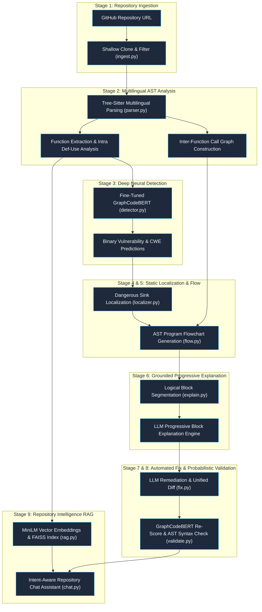

# System Architecture & Analysis Pipeline

VulnExplain executes a 9-stage analysis pipeline (Figure 2) bridging deep learning detection with program analysis and LLM intelligence.

---

## 1. Pipeline Architecture Diagram

---

## 2. Module Index & Responsibilities

| Module | Core Responsibility |
| :--- | :--- |
| `backend/ingest.py` | Shallow clones GitHub repos, filters by file extension, excludes binaries/vendor directories, and caps file count. |
| `backend/parser.py` | Parses C, C++, C#, Go, Java, JS, and Python via Tree-Sitter AST, extracts functions, computes def-use chains, and maps call graphs. |
| `backend/detector.py` | Evaluates function embeddings using fine-tuned GraphCodeBERT with tuned decision thresholds from `threshold.json`. |
| `backend/localizer.py` | Maps CWE categories to severity tiers and identifies exact suspicious sink line numbers via language pattern rules. |
| `backend/flow.py` | Synthesizes deterministic Mermaid `flowchart TD` graphs from static call graphs and def-use chains (no LLM hallucination). |
| `backend/llm.py` | Orchestrates 3-tier fallback chain (Groq free tier → HuggingFace Inference → deterministic offline templates) with prompt injection guards. |
| `backend/explain.py` | Partitions functions into logical statement blocks and provides overall summaries plus progressive block-by-block disclosure. |
| `backend/fix.py` | Generates secure code remediations using guarded LLM prompts and creates unified diffs via Python `difflib`. |
| `backend/validate.py` | Re-evaluates remediated code through GraphCodeBERT, checks AST syntax validity, and assigns empirical risk verdicts. |
| `backend/rag.py` | Chunks code by functions, embeds via `sentence-transformers/all-MiniLM-L6-v2`, and queries persistent FAISS indices. |
| `backend/chat.py` | Detects user query intents across 5 categories, retrieves top-k code chunks, and cites exact `file:line` references. |
| `backend/db.py` | Manages SQLite tables for scans, findings, explanations, and patch diffs. |
| `backend/main.py` | FastAPI application orchestrating asynchronous background scans and serving REST endpoints to the frontend. |
